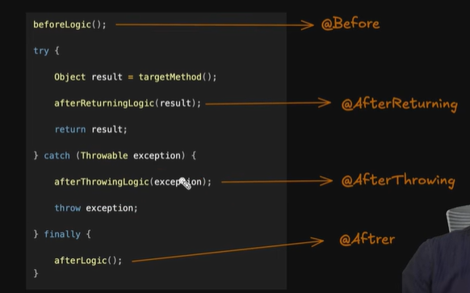

Let's understand The Advice : 
Advice : in AOP combination of when and what called advice 
We use Diffrent Annotation for when 
@Before 
@After
@AfterThrowing
@AfterReturning
@Around

This Annotation take some parameter know as Point-Cut

This is going to be understand by the simple 
try catch and finally block code

Here **_Before_** logic is considered as @Before
    Which is going to be executed before method is called

Now in try block 
  Target method is called which is out studentService.createstudent()

And AfterReturning from target method 

afterReturning login is performed that is **@AfterReturning** not @~~After~~

Lets Assume in try block during execution of target method 
we get some exception then try look for corrospoding catch block 

so in catch block we have somthing like afterthrowing logic

which we call when try throw any exception 
and that was considered as @AfterThrowing 

And we know the finally block is going to be execute no matter what is going on 
that we can relate to the @After
 
